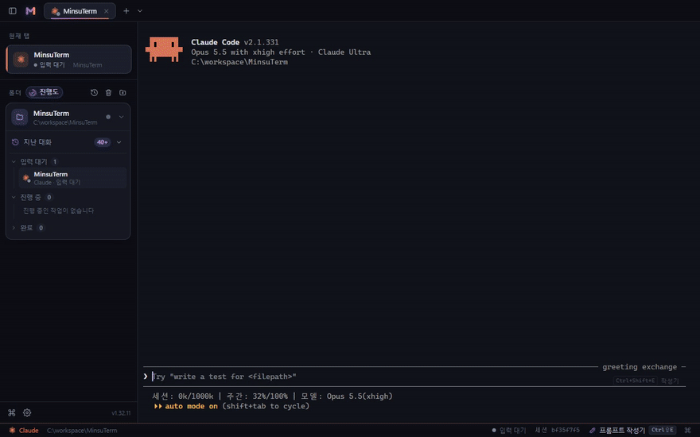

<div align="center">


# MinsuTerm

**Claude Code · Codex CLI 사용자를 위한 Windows / macOS 터미널 앱**
<br>A desktop terminal built for people who work with the **Claude Code** and **OpenAI Codex** CLI agents.

설치만 하면 끝 — 에이전트 작업 현황판, 완료 알림, 세션 복원, 그리고 일하는 시간을 즐겁게 만드는 수백 가지 꾸미기.
<br>Install it and you get an agent dashboard, done notifications, session restore — and hundreds of ways to make the work feel good.

[⬇️ 다운로드 / Download](../../releases/latest) · [English](#english) · [후원하기 / Sponsor](#-후원--support)



</div>

---

## 왜 MinsuTerm인가요?

`claude`나 `codex`를 터미널에서 쓰다 보면 이런 일이 생깁니다.

- 탭이 여러 개라 **어느 에이전트가 아직 일하는지, 어느 쪽이 내 대답을 기다리는지** 모름
- 다른 창을 보다가 **작업이 끝난 줄 모르고** 한참 방치
- 터미널을 껐다 켜면 **어제 하던 대화가 어디 갔는지** 찾아 헤맴
- 몇 시간씩 보는 화면인데 **너무 밋밋함**

MinsuTerm은 평범한 터미널(Windows: cmd / PowerShell, macOS: zsh)에서 `claude`나 `codex`를 실행하는 순간 **에이전트 모드**로 바뀌어 이 문제들을 해결합니다. 별도 설정이나 플러그인은 필요 없습니다.

## 주요 기능

### 🤖 에이전트 뷰 — 한눈에 보는 작업 현황
- 폴더별로 **입력 대기 · 진행 중 · 완료** 작업을 자동 정리 (프롬프트 하나 = 작업 하나)
- 작업 경과 시간, 에이전트 이름(Claude / Codex), 최근 대화 목록
- **서브에이전트(하수인) 표시**: 에이전트가 서브에이전트를 띄우면 작업 아래에 귀여운 하수인 캐릭터가 붙어서 일하고, 끝나면 체크 표시
- 에이전트가 **선택지를 물어보면** 말풍선 배지 + OS 알림 — 다른 창을 보고 있어도 놓치지 않음
- 다른 탭의 작업이 끝나면 데스크톱 알림

### 💾 세션 복원
- 앱을 다시 열면 탭 구성과 **Claude / Codex 대화가 그대로 이어짐**
- 지난 대화 검색 (제목 · 프롬프트), 휴지통에서 복원

### 🎨 꾸미기 — 일하는 시간을 즐겁게


| 항목 | 개수 | 예시 |
|---|---|---|
| 작업 중 테두리 | 35+ | 계주 이어달리기, 산타 썰매, 기차 여행, 개미 행렬, 냠냠 추격전, 네온사인… |
| 작업 완료 축하 | 35+ | 컨페티, 불꽃놀이, 등불, 용, 고래 점프, 반딧불… |
| 완료 문구 띄우기 | 30+ | 팝, 먹물 붓글씨, 칠판, 전구 간판, 슬레이트, 풍선… |
| 배경 애니메이션 | 30+ | 별밤, 오로라, 비, 뇌우, 블랙홀, 신스웨이브… |
| 타이핑 효과 | 35+ | 미니 폭죽, 마법진, 레이저, 이모지 팝, 벚꽃잎… |
| 타이핑 소리 | 45+ | 기계식 키보드, 타자기, 주방, 농장 아침, 오케스트라 튜닝, 마인크래프트 주민… |
| 커서 · 내 프롬프트 표시 · 선택 대기 말풍선 | 40+ · 30+ · 20 | |
| 터미널 색 테마 | 30+ | 다크 · 라이트 각각, 시스템 설정 자동 전환 |


### 🧰 터미널로서도 탄탄하게
- xterm.js 기반 · WebGL 렌더링 · 유니코드 11 · 클릭 가능한 링크 · 찾기
- 탭 드래그로 **화면 분할**, 분할 창 헤더를 끌어서 위치 변경 / 다시 탭으로
- 한글 입력 · Shift+Enter 줄바꿈 · 여러 줄 프롬프트 문제없음
- 파일을 끌어다 놓으면 경로 입력, 창 투명 / 아크릴 효과, UI 크기 조절
- **한국어 · English · 日本語 · 中文** 지원 (꾸미기 항목 이름까지 전부)

## 설치

[Releases](../../releases/latest)에서 받으세요.

| OS | 파일 | 비고 |
|---|---|---|
| Windows 10 / 11 (x64) | `MinsuTerm-Setup-x.y.z.exe` | "Windows의 PC 보호" 창이 뜨면 **추가 정보 → 실행** |
| macOS (Apple Silicon) | `MinsuTerm-x.y.z-mac-arm64.zip` | 아래 macOS 안내 참고 |
| macOS (Intel) | `MinsuTerm-x.y.z-mac-x64.zip` | 아래 macOS 안내 참고 |

<details>
<summary><b>macOS에서 "손상되었기 때문에 열 수 없습니다"가 뜰 때</b></summary>

아직 Apple 공증(유료 개발자 인증)을 받지 않은 앱이라 인터넷에서 받은 파일에 격리 표시가 붙어서 생기는 메시지입니다. 파일이 실제로 손상된 것은 아닙니다. 압축을 푼 폴더에서 터미널로:

```bash
xattr -cr .
bash "MinsuTerm 설치.command"
```

후원금이 모이면 Apple 공증을 받아 이 과정을 없애는 것이 첫 번째 목표입니다.
</details>

**필요한 것**: [Claude Code](https://docs.anthropic.com/en/docs/claude-code) 또는 [Codex CLI](https://github.com/openai/codex)가 설치되어 있으면 됩니다. 터미널에서 `claude` / `codex`를 실행하면 자동으로 에이전트 모드가 켜집니다.

## 자주 묻는 질문 (FAQ)

**Q. Claude Code를 쓰기 좋은 터미널 앱이 있나요?**
MinsuTerm이 바로 그 용도로 만든 터미널입니다. `claude`를 실행하면 작업 진행 상태, 서브에이전트, 선택 대기, 완료 알림을 사이드바에서 보여 주고, 앱을 다시 열면 대화를 이어서 열어 줍니다.

**Q. Codex CLI도 되나요?**
네. `codex`도 같은 방식으로 감지해서 작업 현황, 서브에이전트, 세션 복원을 지원합니다.

**Q. 에이전트 작업이 끝나면 알림을 받을 수 있나요?**
네. 다른 탭이나 다른 앱을 보고 있을 때 작업이 끝나거나 에이전트가 선택지를 물어보면 OS 알림이 옵니다.

**Q. 기존 터미널(Windows Terminal, iTerm2)과 뭐가 다른가요?**
일반 셸 기능은 같고, 그 위에 Claude Code / Codex 전용 기능(에이전트 뷰, 작업 단위 기록, 세션 복원, 서브에이전트 표시, 완료 효과)이 더해져 있습니다. 셸 설정은 그대로 씁니다.

**Q. 무료인가요? 데이터를 어디로 보내나요?**
무료 · 오픈소스(MIT)입니다. MinsuTerm은 어떤 서버로도 데이터를 보내지 않습니다. 대화 기록은 Claude Code / Codex가 원래 저장하는 내 PC의 파일을 읽기만 합니다.

## ☕ 후원 / Support

MinsuTerm은 혼자 만드는 무료 앱입니다. 마음에 드셨다면 커피 한 잔으로 응원해 주세요. 후원금은 macOS 공증, Windows 코드 서명 인증서, 새 기능 개발에 씁니다.

- 💖 **GitHub Sponsors**: 저장소 상단의 **Sponsor** 버튼
- ☕ **Buy Me a Coffee** (해외 카드): https://buymeacoffee.com/minsugwon
- 🇰🇷 **국내 계좌 후원**: iM뱅크 `508-13-061547-7` (예금주: 권민수)

⭐ 별(Star)만 눌러 주셔도 큰 힘이 됩니다!

---

<a id="english"></a>

## English

**MinsuTerm** is a free, open-source Windows / macOS terminal designed for people who use the **Claude Code** and **OpenAI Codex** CLI agents every day.

Run `claude` or `codex` in any tab and MinsuTerm switches to **agent mode**:

- **Agent view** — every prompt becomes a task, sorted into *Waiting for input · In progress · Done* per project folder, with elapsed time.
- **Subagents** — when the agent launches subagents, little "minion" rows appear under the task, work, and get a check mark when they finish.
- **Never miss a question** — when the agent asks you to choose, the task shows a speech-bubble badge and you get a desktop notification.
- **Session restore** — reopen the app and your tabs and Claude / Codex conversations continue where you left off. Search past conversations; restore from trash.
- **Decorations** — 35+ working borders (relay race, Santa's sleigh, train, marching ants…), 35+ celebrations, 30+ done-text styles, 30+ animated backgrounds, 35+ typing effects, 45+ typing sounds, 30+ dark & light color themes.
- **A solid terminal** — xterm.js with WebGL, split panes by dragging tabs, Korean/CJK IME friendly, Shift+Enter newlines, drag-and-drop file paths, window transparency.
- **UI languages** — 한국어, English, 日本語, 中文 (including every decoration name).

**Install** — download from [Releases](../../releases/latest). Windows: run the installer (choose *More info → Run anyway* on the SmartScreen prompt). macOS: unzip; if macOS says the app is "damaged", run `xattr -cr .` in the unzipped folder, then `bash "MinsuTerm 설치.command"` (the app isn't notarized yet).

**Privacy** — MinsuTerm sends nothing anywhere. It only reads the transcript files Claude Code / Codex already keep on your machine.

**Support** — GitHub Sponsors (the *Sponsor* button above) or [Buy Me a Coffee](https://buymeacoffee.com/minsugwon). Sponsorships go toward Apple notarization and Windows code signing.

## License

[MIT](LICENSE) · Sound credits: [SOUND-CREDITS.md](SOUND-CREDITS.md)

<sub>Claude and Claude Code are trademarks of Anthropic. Codex is a trademark of OpenAI. MinsuTerm is an independent project and is not affiliated with or endorsed by either company.</sub>
