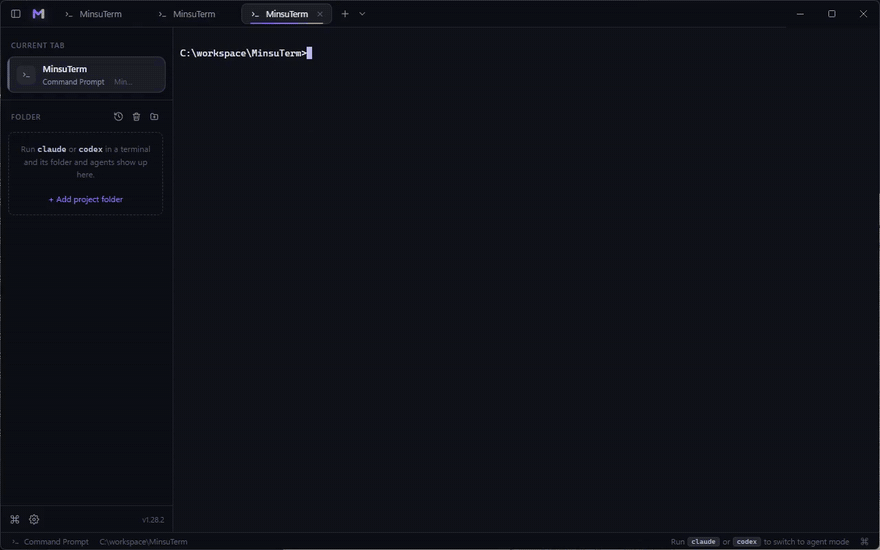
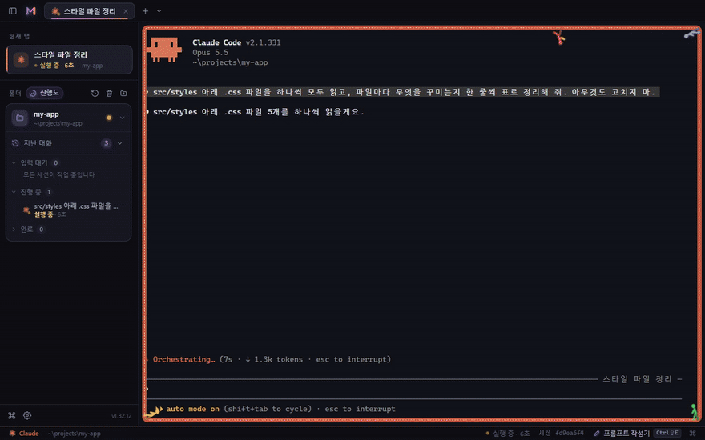
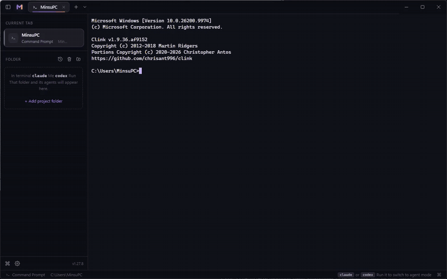

# MinsuTerm

**Claude Code와 Codex를 쓴다면, 터미널은 이걸로.**

어느 탭이 일하는 중인지, 언제 끝났는지, 어제 하던 대화가 어디 있는지 
이제 터미널이 알아서 챙겨 줍니다.

[다운로드](../../releases/latest) · [English](#english) · [후원](#후원)

## 설치하고 claude만 치면 됩니다

평소 쓰던 셸에서 `claude`나 `codex`를 실행하는 순간 에이전트 모드로 바뀝니다. 설정할 건 없습니다.

- **작업 현황판** 폴더별로 대기 / 진행 중 / 완료가 한눈에. 서브에이전트는 귀여운 하수인으로 붙어서 일합니다.
- **알림** 작업이 끝나거나 선택지를 물어보면 바로 알려 줍니다. 다른 창을 보고 있어도요.
- **세션 복원** 껐다 켜도 탭과 대화가 그대로 이어집니다.
- **화면 분할** 탭을 끌어다 놓으면 끝.
- **프롬프트 작성기** 긴 프롬프트는 따로 편하게 쓰고 한 번에 보내기.
- **진행도 보기** 폴더마다 에이전트가 지금 하는 일, 다음 할 일, 끝낸 일과 내가 해 줘야 할 일을 한 화면에서.
- **꾸미기** 일하는 동안 테두리를 달리는 계주 선수, 끝나면 터지는 축하 효과, 배경, 타이핑 효과와 효과음, 움직이는 커서까지.
- **한국어 / English / 日本語 / 中文**

### 화면 분할

탭을 화면으로 끌어다 놓으면 나뉘고, 창 머리를 끌면 자리를 바꾸거나 다시 탭으로 돌아갑니다.

### 프롬프트 작성기

상태 줄의 프롬프트 작성기 버튼이나 Ctrl+Shift+E로 작성기를 열어 긴 프롬프트를 편하게 쓰고 Ctrl+Enter로 보내세요. Claude나 Codex가 입력을 기다릴 때는 입력 줄 끝에 흐리게 뜨는 작성기 안내를 눌러도 열립니다. 커서와 타이핑 효과도 그대로 나옵니다.

### 진행도 보기

사이드바 폴더 머리의 진행도 버튼(Ctrl+Shift+J)을 누르고 추가한 프로젝트 폴더를 고르면, 그 폴더에서 에이전트가 적는 할 일과 진행 상황이 터미널 자리에 실시간으로 뜹니다. 확인할 일이 생기면 버튼에 그 수가 표시됩니다. 요청을 남기거나 먼저 할 일을 고를 수도 있습니다. 처음 한 번 **구축하기**를 누르면 필요한 스킬이 설치되고, Node가 없는 컴퓨터에서도 동작합니다.

### 작업 중 테두리와 테마

에이전트가 일하는 동안 테두리를 따라 무언가 달립니다. 다크와 라이트 테마도 골라 쓰세요.

### 배경, 타이핑 효과, 커서

밤하늘 불꽃, 마왕성, 한국의 밤... 배경과 타이핑 효과, 커서를 기분 따라 바꿔 보세요.

## 다운로드

[Releases](../../releases/latest)에서 Windows는 `.exe`, Mac은 칩에 맞는 `.zip`(Apple Silicon은 `arm64`, Intel은 `x64`)을 받으세요.

- Windows에서 "PC 보호" 창이 뜨면 **추가 정보 > 실행**
- Mac에서 "손상되었다"고 나오면 압축 푼 폴더에서 `xattr -cr .` 실행 후 `bash "MinsuTerm 설치.command"`

무료, 오픈소스(MIT)입니다. 인터넷으로 보내는 데이터는 없습니다.

## 후원

혼자 만드는 앱입니다. 마음에 드셨다면 커피 한 잔으로 응원해 주세요. 위의 설치 경고를 없애는 데(Apple 공증, Windows 코드 서명) 먼저 쓰겠습니다.

[Buy Me a Coffee](https://buymeacoffee.com/minsugwon) · GitHub Sponsors(위쪽 Sponsor 버튼) · iM뱅크 `508-13-061547-7` (권민수)

Star 하나도 큰 힘이 됩니다.

---

## 자주 묻는 질문

**Claude Code 쓰기 좋은 터미널이 있나요?**
MinsuTerm이 그 용도로 만든 터미널입니다. 작업 현황과 서브에이전트를 보여 주고, 끝나면 알려 주고, 다시 열면 대화를 이어 줍니다.

**Codex CLI도 되나요?**
네. `codex`도 똑같이 인식합니다.

**지금 쓰는 셸이나 설정을 바꿔야 하나요?**
아니요. cmd, PowerShell, zsh 등 원래 쓰던 셸을 그대로 씁니다.

**무료인가요? 내 데이터는 어디로 가나요?**
무료(MIT)이고, 인터넷으로 보내는 건 없습니다. Claude Code / Codex가 원래 PC에 저장하는 대화 기록 파일을 읽기만 합니다.

**진행도 보기는 무엇을 설치하나요?**
처음 구축하기를 누를 때만 `~/.claude/skills`에 `minsuterm-progress`(진행 보고)와 `minsuterm-dreaming`(자러 가기 때 기억 정리) 스킬을 넣습니다. 진행 기록은 그 폴더의 `progress/`에 남고 git에는 올라가지 않으며, 진행도 페이지는 이 컴퓨터 안(127.0.0.1)에서만 열립니다.

---

## English summary

**MinsuTerm is the terminal for Claude Code and Codex.** It's a free, open-source (MIT) app for Windows and macOS.

Run `claude` or `codex` in your usual shell (cmd, PowerShell, zsh) and the tab switches to agent mode. No setup needed.

- **Agent dashboard.** Prompts are grouped by project folder into waiting / in progress / done. Subagents show up as little minions under the task.
- **Notifications.** Get notified when an agent finishes or asks you to pick an option, even while you're in another app.
- **Session restore.** Close the app and your tabs and Claude / Codex conversations come back next time.
- **Split panes.** Drag a tab onto the terminal to split it.
- **Prompt composer.** Write long, multi-line prompts in a separate editor and send them in one go. Open it from the status bar, with Ctrl+Shift+E, or from the hint at the end of the agent's input row.
- **Progress view.** Open a folder's progress from the progress button in the sidebar's folder header (Ctrl+Shift+J), which also counts what needs your attention: what the agent is doing, what's next, what's done and what it needs from you, live in the terminal area. One click sets up the skills it needs (`minsuterm-progress`, `minsuterm-dreaming`); it works without Node, and the page is served on 127.0.0.1 only.
- **Decorations.** Working borders (a relay race, Santa's sleigh...), celebrations when a task is done, animated backgrounds, typing effects and sounds, animated cursors, dark and light themes.
- **Languages.** Korean, English, Japanese, Chinese.

**Download** from [Releases](../../releases/latest): the `.exe` for Windows, or the `.zip` for your Mac (`arm64` for Apple Silicon, `x64` for Intel). On Windows, choose *More info > Run anyway* if SmartScreen appears. On macOS, if the app is reported as damaged, run `xattr -cr .` in the unzipped folder, then `bash "MinsuTerm 설치.command"`. The app isn't notarized yet.

**Privacy.** Nothing is sent over the network. MinsuTerm only reads the transcript files Claude Code and Codex already keep on your computer.

**Support.** It's a one-person project. If you like it, [buy me a coffee](https://buymeacoffee.com/minsugwon) or sponsor on GitHub. It goes toward Apple notarization and Windows code signing first.

Claude and Claude Code are trademarks of Anthropic. Codex is a trademark of OpenAI. MinsuTerm is an independent project. Sound credits: [SOUND-CREDITS.md](SOUND-CREDITS.md). Icon font: Symbols Nerd Font, MIT ([license](src/renderer/fonts/NERD-FONTS-LICENSE.txt)).
